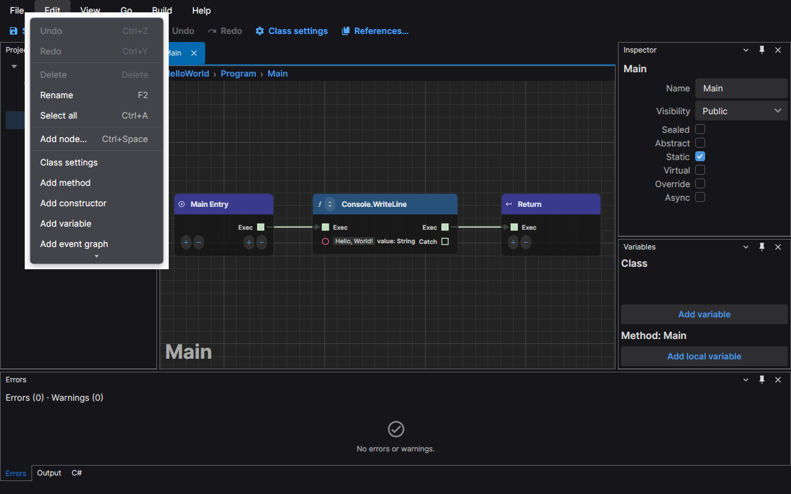
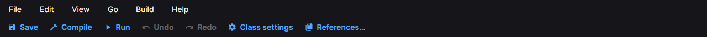
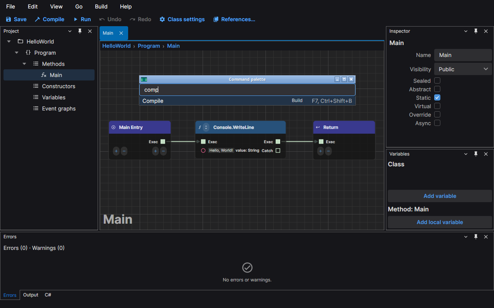
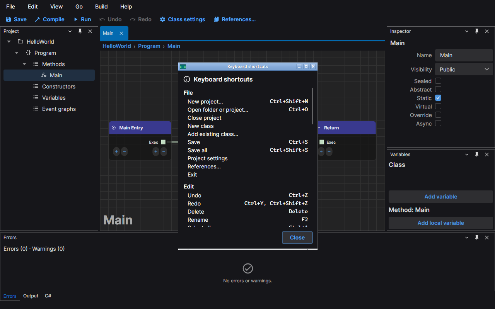

# Commands and shortcuts

Everything the editor does is a command. A command is listed in a menu, may have a button in the command bar and a
keyboard shortcut, and can always be found in the command palette. This page shows the four ways to run one.

## The menus

The menu bar has six menus.

| Menu | What is in it |
|---|---|
| **File** | New project, open, close, new class, save, save all, project settings, settings, references, exit |
| **Edit** | Undo, redo, delete, rename, select all, add node, class settings and the commands that add a method, a constructor, a variable, an event graph or an override |
| **View** | Frame selection and fit all on the canvas, the panels, float and dock a tab, reset layout, the theme, the command palette |
| **Go** | Go to anything, back and forward, switching and closing tabs, go to source and target |
| **Build** | Compile, run and stop |
| **Help** | The keyboard shortcuts, the start page, open the logs folder, about |

A menu item shows its shortcut on the right and is greyed out while it cannot run, such as Undo with nothing to undo.
Related items sit in groups separated by lines, and **View › Theme** is a submenu.

## The command bar

The command bar under the menus holds the commands you use most, each with an icon and its name, in this order:

**Save**, **Compile**, **Run** (which turns into **Stop** while your program runs), **Undo**, **Redo**, **Class
settings** and **References…**. A button is greyed out while its command cannot run, as in the menu.

## The command palette

Press **Ctrl+Shift+P** (or choose **View › Command palette…**) to open the palette. It lists every command in the
editor, including the ones that have no menu entry, with the menu each one belongs to and its shortcut. Type to
filter, move with the arrow keys and press **Enter** to run the selected command; a command that cannot run now
is listed too, and Enter does nothing for it. **Esc** closes the palette without running anything.

To find a graph, a node, a variable or a method instead of a command, use **Go › Go to anything…** (Ctrl+P); see
[Navigation](./navigation.md).

## Keyboard shortcuts

**Help › Keyboard shortcuts** opens a sheet with every command grouped as the menus are, with its shortcuts. The
start page's Learn card opens the same sheet.

The table below is the same list. A shortcut marked *Graph canvas* works while the graph canvas has focus, one
marked *Project tree* while the project tree has focus, one marked *Variables panel* while a list of the
Variables panel has focus (on its selected row), and the rest work anywhere in the window. A command with
two shortcuts lists both. A dash means the command has no shortcut; it is still in the menu and the palette.

<!-- shortcuts:begin -->

| Menu | Command | Shortcut | Works in |
|---|---|---|---|
| File | New project… | Ctrl+Shift+N | Anywhere |
| File | Open project… | Ctrl+O | Anywhere |
| File | Open folder… | – | Anywhere |
| File | Close project | – | Anywhere |
| File | New class | – | Anywhere |
| File | Add existing class… | – | Anywhere |
| File | Save | Ctrl+S | Anywhere |
| File | Save all | Ctrl+Shift+S | Anywhere |
| File | Project settings | – | Anywhere |
| File | References… | – | Anywhere |
| File | Settings | Ctrl+, | Anywhere |
| File | Exit | – | Anywhere |
| Edit | Undo | Ctrl+Z | Anywhere |
| Edit | Redo | Ctrl+Y, Ctrl+Shift+Z | Anywhere |
| Edit | Delete | Delete | Graph canvas, Project tree, Variables panel |
| Edit | Rename | F2 | Graph canvas, Project tree, Variables panel |
| Edit | Select all | Ctrl+A | Graph canvas |
| Edit | Add node… | Ctrl+Space | Graph canvas |
| Edit | Class settings | – | Anywhere |
| Edit | Add method | – | Anywhere |
| Edit | Add constructor | – | Anywhere |
| Edit | Add variable | – | Anywhere |
| Edit | Add event graph | – | Anywhere |
| Edit | Override method… | – | Anywhere |
| View | Frame selection | F | Graph canvas |
| View | Fit all | Home, Shift+F | Graph canvas |
| View | Project | – | Anywhere |
| View | Inspector | – | Anywhere |
| View | Variables | – | Anywhere |
| View | Errors | – | Anywhere |
| View | Output | – | Anywhere |
| View | C# | – | Anywhere |
| View | Float tab | – | Anywhere |
| View | Dock tab | – | Anywhere |
| View | Reset layout | – | Anywhere |
| View | Theme › Dark | – | Anywhere |
| View | Theme › Light | – | Anywhere |
| View | Theme › System (follow OS) | – | Anywhere |
| View | Command palette… | Ctrl+Shift+P | Anywhere |
| Go | Go to anything… | Ctrl+P | Anywhere |
| Go | Back | Alt+Left | Anywhere |
| Go | Forward | Alt+Right | Anywhere |
| Go | Next tab | Ctrl+Tab | Anywhere |
| Go | Previous tab | Ctrl+Shift+Tab | Anywhere |
| Go | Close tab | Ctrl+W | Anywhere |
| Go | Go to source | – | Graph canvas |
| Go | Go to target | – | Graph canvas |
| Build | Compile | F7, Ctrl+Shift+B | Anywhere |
| Build | Run | F5 | Anywhere |
| Build | Stop | Shift+F5 | Anywhere |
| Help | Keyboard shortcuts | – | Anywhere |
| Help | Start page | – | Anywhere |
| Help | Open logs folder | – | Anywhere |
| Help | About NetPrints | – | Anywhere |
| Other | Cancel | Esc | Graph canvas |
| Other | Open | Enter | Project tree |

<!-- shortcuts:end -->

The rows of **Other** are commands with no menu entry: Esc closes a popup that is open on the graph canvas, and Enter
opens the graph selected in the project tree.

The table is the list of commands the editor registers, in the order of the menus. It shows the defaults; the sheet and
every menu, tooltip and the palette show the shortcuts in force, including your changes.

## Change a shortcut

Open **Settings** (Ctrl+,) and choose the **Keyboard shortcuts** page, or press **Edit shortcuts** on the shortcuts
sheet. The page has one row for every command, built-in or from an extension, with its label, owner, scope, default
shortcuts and current shortcuts. Type in the filter to find a command by label, id or owner, or press **Record gesture**
and then a key combination to list the commands that use it.

From the keyboard: Ctrl+, puts you in the settings search. Type "Keyboard", press Down to pick the first page that matches and Tab to reach the filter. Type part of a command's label, id or owner and press Enter to record a gesture for the first command the filter shows, then press the combination. After each change the keyboard returns to the filter. When the page asks about a conflict, Enter on Move takes the combination and Esc cancels. Tab from the filter reaches Record gesture, Reset all and the buttons of each row.

- **Add gesture** on a row, then press the key combination. The change applies at once.
- The **✕** beside a shortcut removes it. **Reset** on a row restores that command's defaults, and **Reset all**
  restores every command.
- If another command already uses the combination in a scope that overlaps, the page names that command first. **Move**
  takes the combination from it; **Cancel** changes nothing.
- A single key or Shift plus one key cannot be used for a command that works anywhere in the window; function keys
  can. The page tells you when it refuses a combination. Press **Esc** to stop recording.
- On macOS **Ctrl** in a combination means the Command key.

Your changes are saved as differences from the defaults in the `keyboard` section of `settings.json`, so a new default
in a later version still reaches you. Changes for a command that is not loaded, such as an extension you removed, stay
in the file and are listed under **Not loaded**, where you can remove them. A combination in the file that cannot be read
is listed on the page and ignored. When two commands claim one combination, a command you changed wins over a built-in
default, and a built-in default wins over an extension default.
