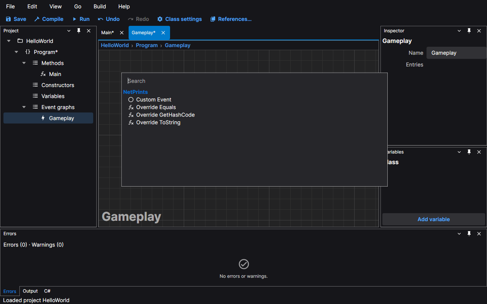
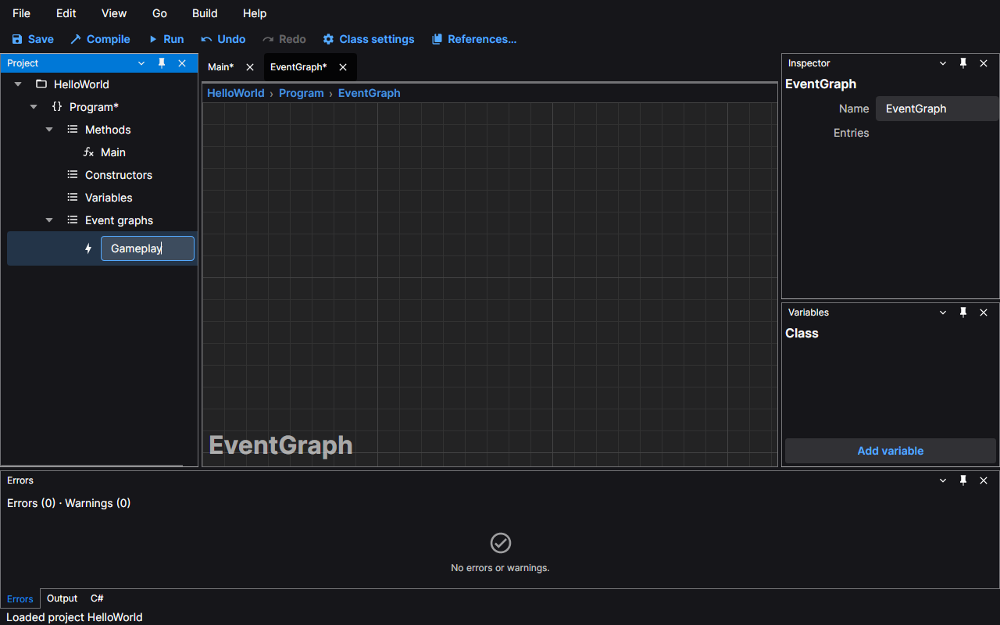
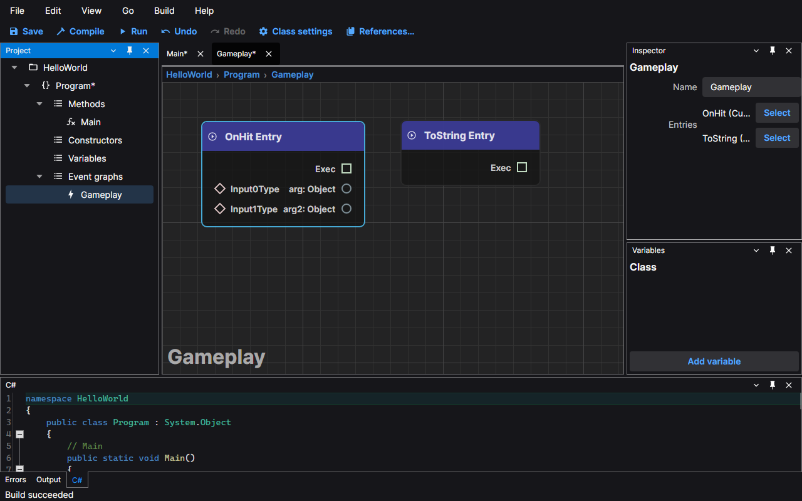
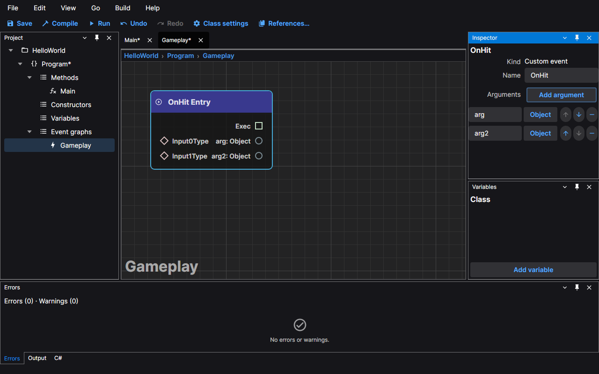
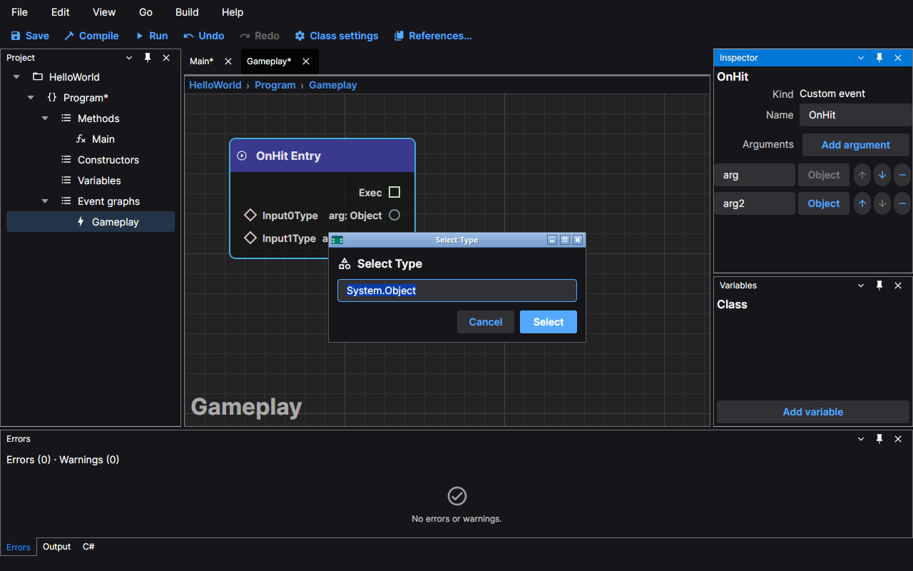
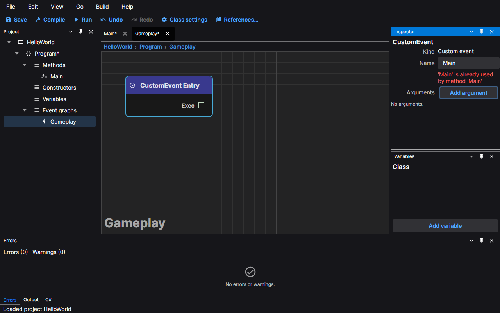
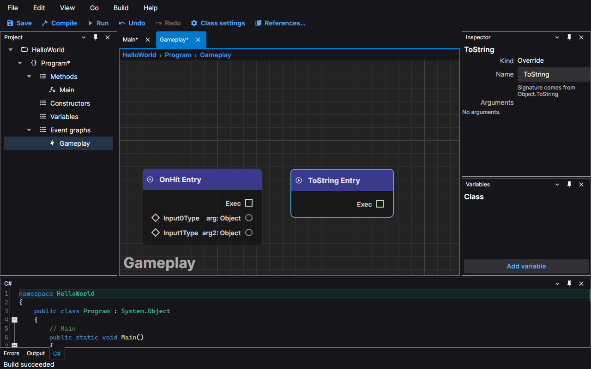
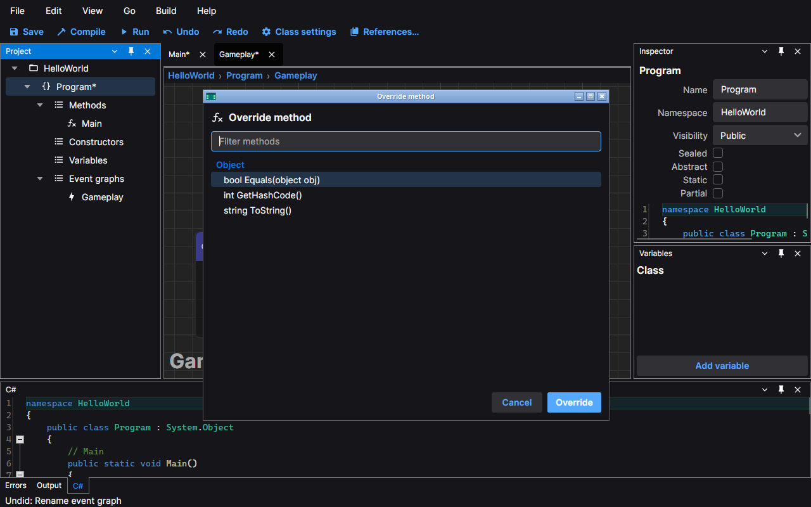

# Event graphs

An event graph holds events: places where your class starts running a chain of nodes. Each event starts at an
**entry** node, and each entry becomes one method of the generated class. This page shows how to add an event graph,
rename it, add entries to it, give a custom event arguments and override a method of the base class. The screenshots
use the default dark theme and the HelloWorld sample.

## Add an event graph

Select the class in the Project panel and choose **Edit › Add event graph**. A new graph called `EventGraph` is added
under the class's **Event graphs** group and opens in its own tab. It starts empty.

Right-click the canvas to open the node search. In an event graph it offers the two kinds of entry:

- **Custom Event**, an event of your own;
- **Override** followed by the name of a method of the base class, such as **Override ToString**.

Choose one and its entry node is placed where you clicked. A graph can hold several entries.

## Rename an event graph

An event graph's name is a label for you. It is not a member of the generated class, so it never appears in the
generated C#; each entry names its own method.

To rename it in place, select its row in the Project panel and press **F2** (or choose **Edit › Rename**). The row
becomes a text box: type the new name and press **Enter**, or press **Esc** to keep the old one.

You can also select the graph in the Project panel and change the **Name** box in the Inspector. The tab and the
breadcrumbs show the new name at once, and each rename is one step of **Undo**.

## The Inspector for an event graph

Select an event graph in the Project panel and the Inspector shows its name and an **Entries** list. Each line gives the
name of an entry, its kind and how many arguments it has, such as `OnHit (Custom event, 2 arguments)`; the panel is
narrow, so a long line is cut short. The **Select** button beside a line selects that entry on the canvas and shows it in
the Inspector.

## A custom event

Select the entry node of a custom event, or press **Select** for it in the list above, and the Inspector shows:

- **Kind**: Custom event.
- **Name**: the name of the generated method. Edit it and press **Enter** or **Tab**.
- **Arguments**: an **Add argument** button and one row for each argument.

**Add argument** adds an argument called `arg` (then `arg2` and so on) of type `Object`. In each row:

- the text box renames the argument;
- the type button opens the **Select Type** window, where you choose another type and press **Select** (**Cancel** or Esc closes it and keeps the current type);
- the arrow buttons move the argument up or down, and the minus button removes it.

The entry node on the canvas gets a pin for each argument, and the generated method gets a parameter for it. Every
change is one step of **Undo**, and calls to the event in other graphs follow the new name and arguments.

The name must be a valid C# identifier and must not be used by another method of the class or by another event. A
name the editor refuses stays as it was, and a message under the box says why.

## Overriding a method of the base class

An **Override** entry makes your class replace a method it inherits. Choose **Override ToString** (or another method) in
the node search of an event graph, and the entry node appears with the method's name.

The kind is **Override**, and the name and the arguments come from the method in the base class, so they cannot be
changed: the name box does not accept an edit, a note says where the signature comes from, and there is no **Add
argument** button.

The other way to override a method is **Edit › Override method…**. It opens a window that lists the methods of the
base classes, for example `string ToString()`; type to filter the list and press **Enter** or **Override**. This one
adds the method to the class's **Methods** group and opens its graph. Methods that the class already overrides this way
are dimmed and cannot be chosen again.

