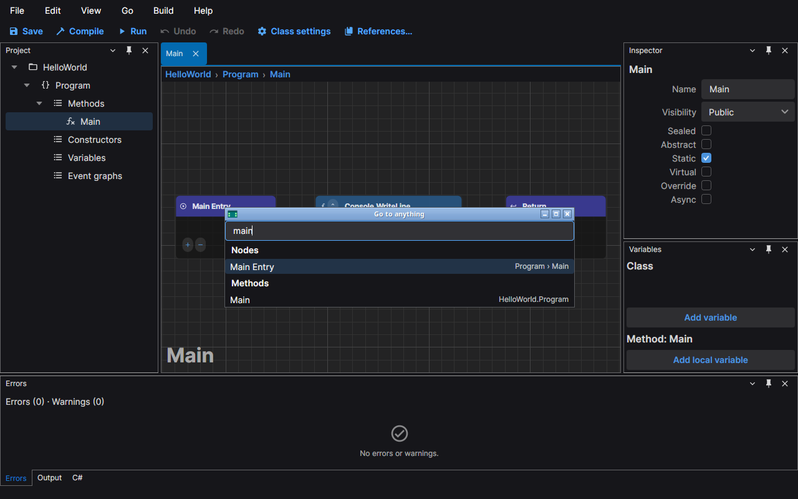
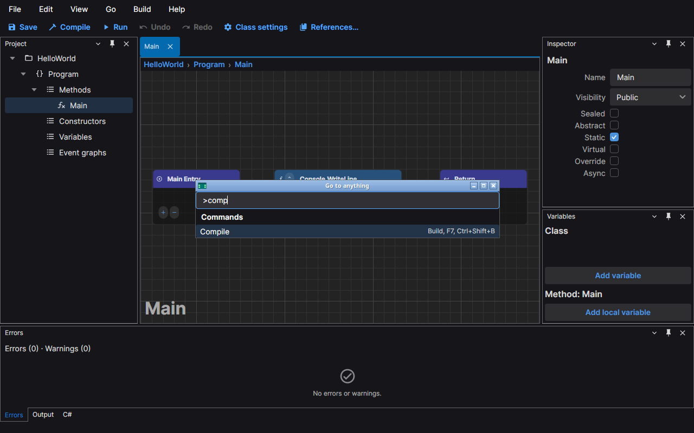
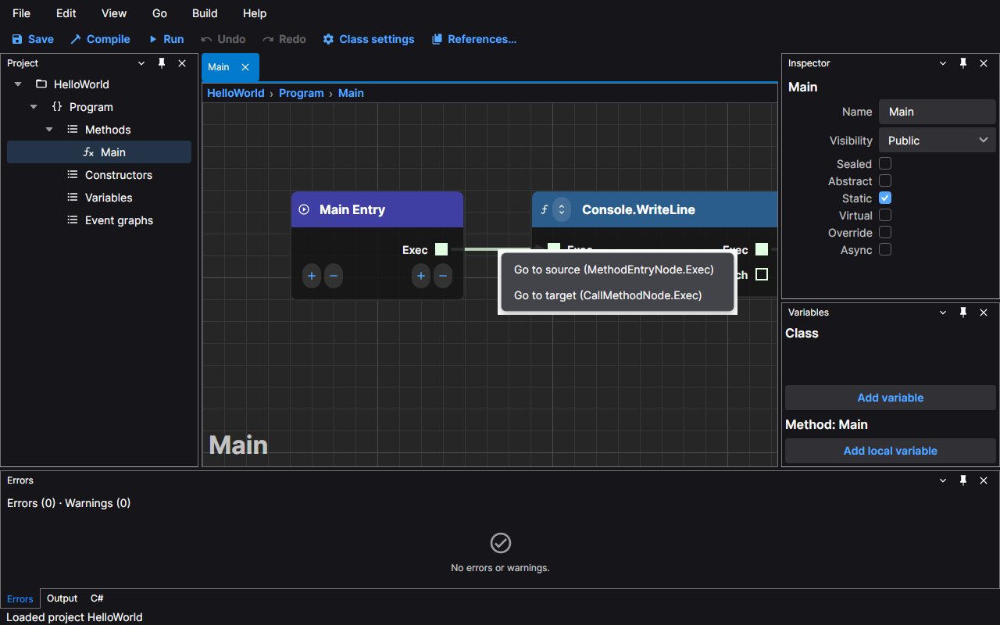
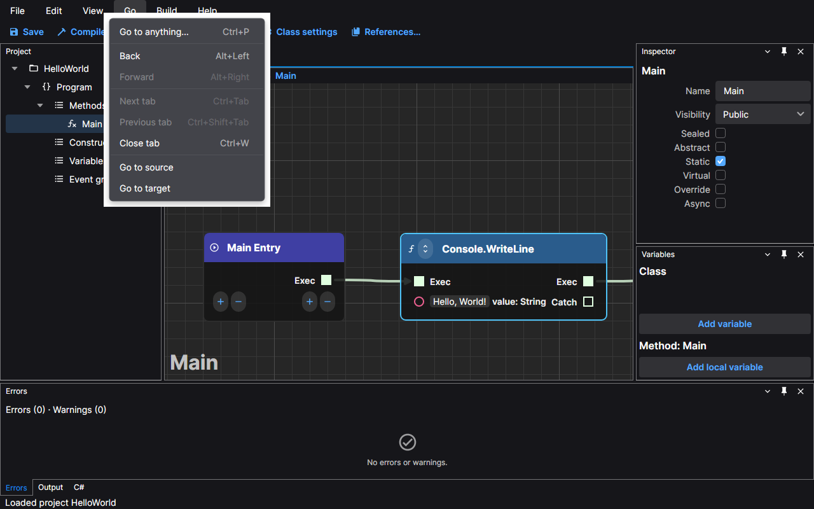
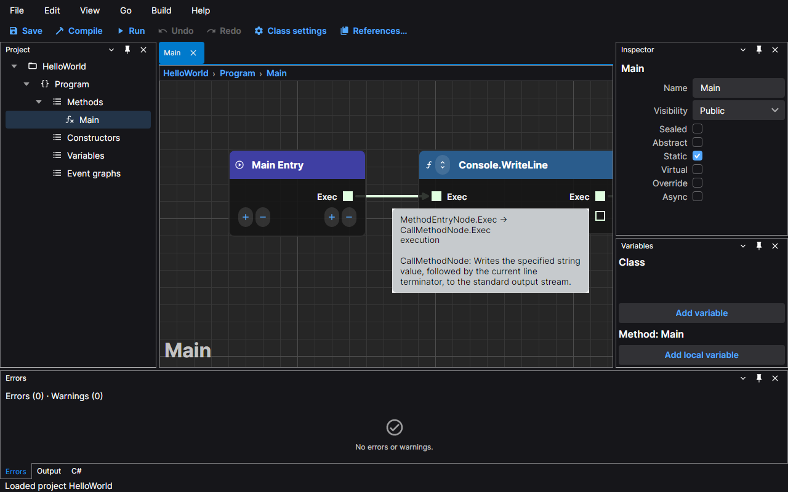
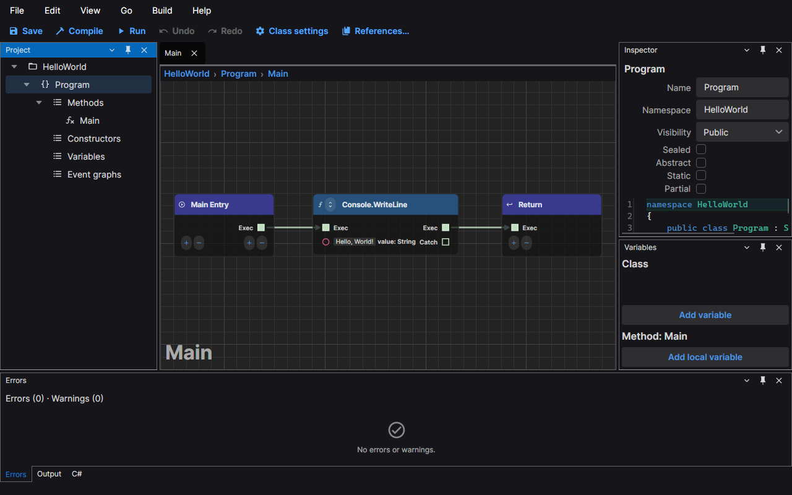

# Navigation

This page covers the ways to get around a project: finding a graph, a node, a variable or a method by name, jumping
along a connection, going back to where you were, and reading a connection's tooltip. The screenshots use the default
dark theme and the HelloWorld sample.

## Go to anything

Press **Ctrl+P** (or choose **Go › Go to anything…**) and type. The window searches the open project and lists what it
finds under a heading for each kind:

- **Graphs**: the class graph, the constructors and the event graphs.
- **Nodes**: the nodes of every graph. Nodes are listed only once you have typed something, and at most 100 are shown.
- **Variables**: the variables of the classes.
- **Methods**: the methods of the classes.

Each row shows its title on the left and where it is on the right: a node names its class and graph
(`Program › Main`) and a method names its class. A name that starts with the text you typed comes first, then a name
with a word that starts with it, then any other name that contains it; the case does not matter. The best match is
selected. Move with the **Up** and **Down** arrows and press **Enter** (or double-click a row) to go there: the graph
opens, and for a node it is selected and brought into view. **Esc** closes the window without going anywhere. When
nothing matches, the list says "No results".

Start the text with `>` to search the commands instead of the project. The rows then belong to **Commands** and show
the menu of each command and its shortcuts; Enter runs the command.

This is the same list as the [command palette](./commands-and-shortcuts.md#the-command-palette), reached from the
same window.

## Jump along a connection

A long cable leaves its far end off the screen. Hold **Ctrl** and click the cable to go to the end that is farther
from where you clicked: that node is selected and the view moves to it. Click near the node you are looking at and you
jump to the one at the other end. On macOS, hold **Cmd** instead of Ctrl.

Right-click the cable for a menu with the two ends named, such as **Go to source (MethodEntryNode.Exec)** and
**Go to target (CallMethodNode.Exec)**.

The **Go** menu has the same two commands, **Go to source** and **Go to target**, for the node you have selected. They
work when exactly one connection reaches the selected node from that side, and are greyed out otherwise.

## Back and forward

The editor remembers the views you leave when you:

- go to something with Go to anything;
- activate a row of the Errors panel;
- jump along a connection;
- switch to another tab.

A view is a graph with its zoom, its position and its selection. **Alt+Left** (or **Go › Back**) returns to the
previous one, exactly as you left it, and **Alt+Right** (or **Go › Forward**) goes the other way. The menu items are
greyed out when there is nowhere to go.

The editor keeps the last 50 views in each direction. Going somewhere new clears the forward list, and a view whose
graph no longer exists is skipped. A graph you closed is opened again when you go back to it.

## Connection tooltips

Rest the pointer on a cable for a moment and a tooltip names its two ends as `Node.pin → Node.pin`, then gives the
data type it carries, or **execution** for an execution cable. When the nodes at either end have documentation, such
as the .NET documentation of the method a call node runs, it follows. The names are the ones the editor gives the nodes
(`MethodEntryNode`, `CallMethodNode`), which are also the names the cable menu uses.

## Breadcrumbs

Above every graph, a row of buttons shows where it is: the project, the class and the graph.

Click a segment to find it in the Project panel: the panel is shown if you had closed it, the row of that item is
selected and the Inspector shows its details. The segments follow a rename at once.

