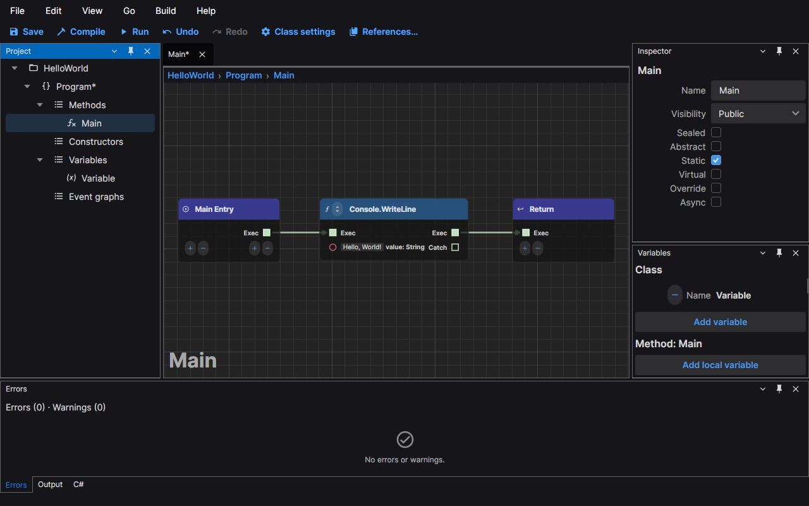
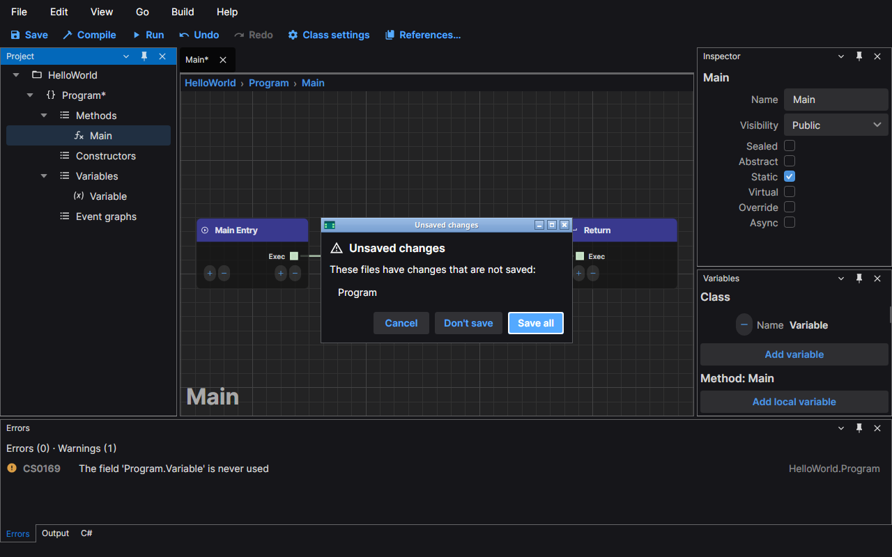
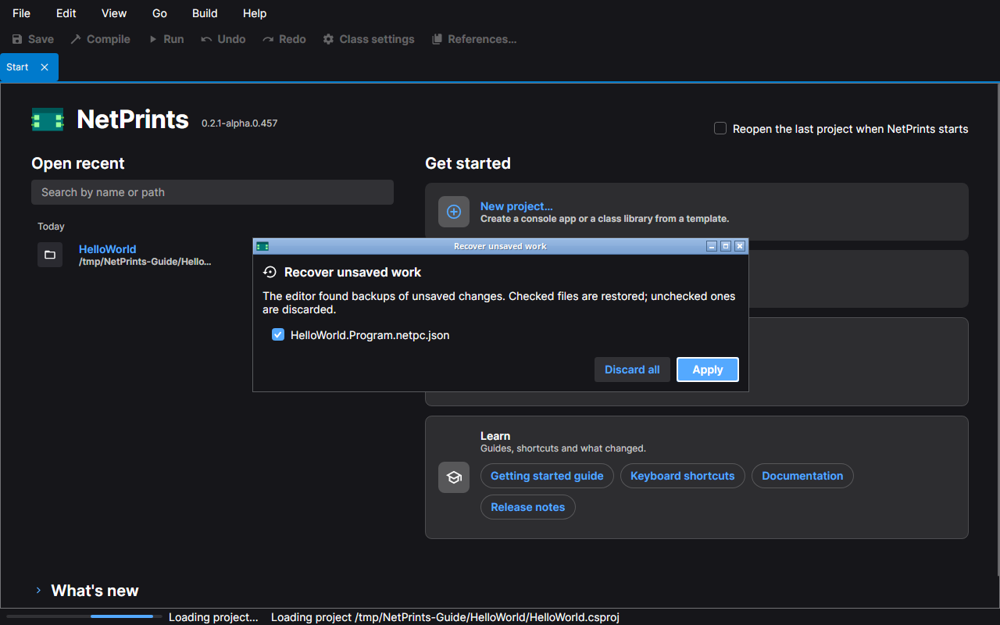

# Saving and recovery

The editor tells you what is unsaved, asks before it throws changes away, and keeps a copy of unsaved work outside
your project so a crash or a power cut does not lose it.

## Unsaved markers

A file with changes that are not saved is marked with `*` in three places:

- on the tab of each of its graphs (`Main*`);
- on its class in the Project panel (`Program*`);
- in the window title, after the project name (`Main* – HelloWorld* – NetPrints`), while any file is unsaved.

The marker goes away when you save, and also when you undo back to the state that was saved.

**Save** (Ctrl+S) saves the file of the active graph; **Save all** (Ctrl+Shift+S) saves every unsaved file. Both are
in the File menu, and Save is in the command bar.

## The unsaved changes prompt

When an action would unload the project while a file is unsaved, the editor lists the unsaved files and asks. This
happens when you close the window, choose **File › Exit**, choose **File › Close project**, or open or create another
project. Closing a single tab never asks; the change stays in the editor, and the file keeps its marker, until you save.

- **Save all** saves every file in the list and goes on with what you asked for. It is the default button.
- **Don't save** goes on and discards the changes.
- **Cancel** (or Esc) stays in the editor with every change still there. If a save fails, the editor also stays
  open and keeps the changes.

## Backups

The editor writes a backup of every unsaved file 30 seconds after your last change to it. Each new change restarts
the wait, so a backup is written when you pause. A backup holds exactly what Save would write.

Backups are never kept in your project. They are in your user profile, in the editor's state folder, under
`backups/<project key>/`, where the project key names the project by its path. A backup is deleted when you save the
file, when you choose Don't save and when you discard it during recovery. When the editor starts it also deletes
backups older than 30 days and backups of projects that no longer exist.

If a backup cannot be written the editor keeps working, shows a warning in the status bar once and writes the
reason to the log.

## Recovery

If the editor is closed without a chance to ask (it crashed, the process was killed or the machine lost power), the
backups are still there. The next time you open that project the editor offers them before it loads anything.

The prompt lists each backed-up file with a check box.

- A checked file is restored: its backup is loaded as unsaved changes, so it has the `*` marker and nothing is
  written to your file until you save. A class that had never been saved is offered too, and comes back as a new,
  unsaved class.
- An unchecked file is discarded: its backup is deleted.
- A file that has been changed on disk since the backup was taken starts unchecked, with a note, so a stale backup
  does not overwrite newer work by accident.

**Apply** does what the boxes say. **Discard all** deletes every backup in the list. There is no Esc binding: you
have to choose.

## Nothing is written into the project

The editor writes into your project folder only when you save: the graph files (`*.netpc.json`) and the project file.
The window position, the layout, the recent projects, the open tabs, the backups and the logs are all kept in your
user profile, as listed below, and never in a project, so a project folder stays clean in version control.

## Where the editor keeps its files

The editor keeps one folder of its own per user (the *state folder*) and one for logs.

| System | State folder | Logs |
|---|---|---|
| Windows | `%LOCALAPPDATA%\NetPrints` | `%LOCALAPPDATA%\NetPrints\logs` |
| Linux | `$XDG_STATE_HOME/NetPrints`, or `~/.local/state/NetPrints` when that variable is not set to an absolute path | `<state folder>/logs` |
| macOS | `~/Library/Application Support/NetPrints` | `~/Library/Logs/NetPrints` |

Inside the state folder:

| Path | Content |
|---|---|
| `state/window.json`, `state/layout.json` | the window's bounds and the panel layout |
| `state/recent.json`, `state/start.json` | the recent projects and the start page's memory |
| `state/sessions/` | the open tabs and canvas positions of each project |
| `backups/` | the backups described above |

On Linux and macOS the folders are created readable by you only, because backups hold your project's content.

Two environment variables move them: `NETPRINTS_STATE_DIR` replaces the state folder and `NETPRINTS_LOG_DIR`
replaces the logs folder.

Your settings, such as the theme, stay in `settings.json` in the `NetPrints` folder of your application data folder
(`~/.config/NetPrints` on Linux, `%APPDATA%\NetPrints` on Windows, `~/Library/Application Support/NetPrints` on macOS);
that file is meant to be edited by hand when you need to, and it is not moved.

Earlier versions kept the state and the backups in your application data folder (`~/.config/NetPrints` on Linux, `%APPDATA%\NetPrints` on Windows). The first
start of this version moves them to the folders above. If a move fails the old folder stays where it was and the
reason is in the log.

## Logs

Each run of the editor writes its own log file, named from its start time (UTC) and process id:
`netprints-20261014-093015-12345.log`. The editor keeps the 20 earlier files and deletes older ones when it starts.
A line holds the time, the level, the component and the message; an exception follows on the next lines. The
default level is Information; set `NETPRINTS_LOG_LEVEL` to `Debug`, `Warning` or another level name to change it.
An exception that ends the editor is written to the log with level Critical before the process exits.

**Help › Open logs folder** opens the folder in your file manager. Attach the latest file to a bug report; it holds
paths of your projects, so read it first.
