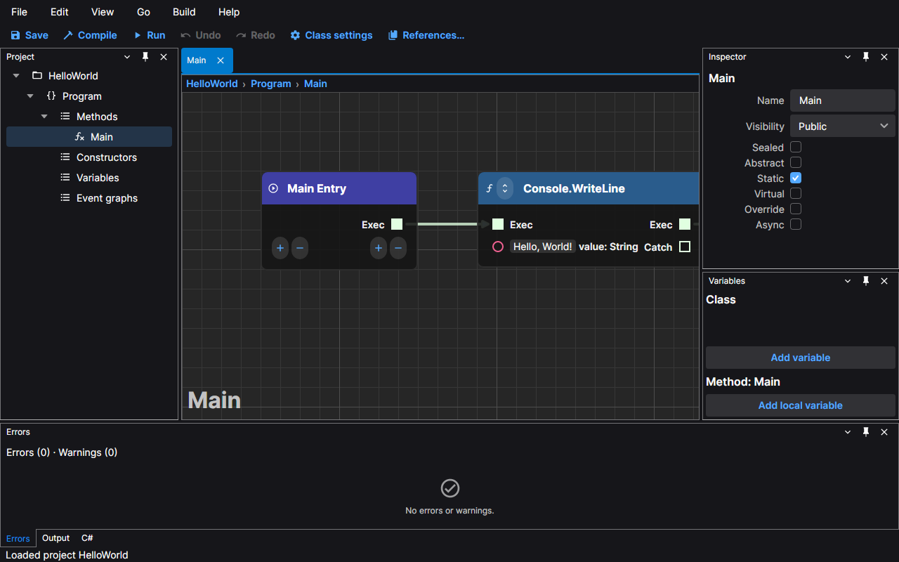
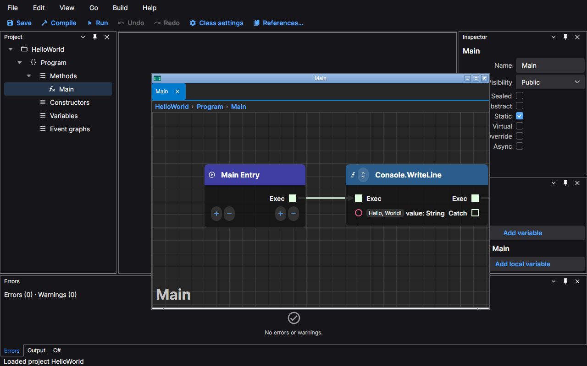

# The editor window

The editor has one window per open project. This page covers what is in it, how to move the parts around and how to
get the default arrangement back. The screenshots use the default dark theme and the HelloWorld sample.

## Layout

From the top down:

- **The menu bar**: File, Edit, View, Go, Build and Help. Every command in the editor is in a menu. See
  [Commands and shortcuts](./commands-and-shortcuts.md).
- **The command bar**: the buttons you use most: Save, Compile, Run (it becomes Stop while the program runs), Undo,
  Redo, Class settings and References.
- **The Project panel**, on the left: the project, its classes and, for each class, its Methods, Constructors,
  Variables and Event graphs. Double-click a graph to open it.
- **The document area**, in the middle: one tab per open graph, and the Start tab while no project is open. Above the
  canvas a breadcrumb shows the project, the class and the graph.
- **The Inspector**, on the right: the details of what is selected, in the tree or on the canvas (a class, a method,
  a variable, an event entry).
- **The Variables panel**, below the Inspector: the variables of the class of the active graph and, when the active
  graph is a method, its local variables.
- **The bottom panels**: **Errors** (the problems found while you edit and in the last build; activate a row to open
  its graph and select the node), **Output** (the build output, then what your program prints) and **C#** (the code
  generated from the active graph's class).
- **The status bar**: the last message, the state of the build and a warning if a backup could not be written.

The window title names the active graph and the project: `Main – HelloWorld – NetPrints`. A `*` after the project
name means a file has unsaved changes (see [Saving and recovery](./saving-and-recovery.md)).

## Opening and closing panels

Each panel has a header with its name and buttons on the right. The close button hides the panel and the others
beside it take its room. To bring a hidden panel back, choose its name in the **View** menu: Project, Inspector,
Variables, Errors, Output or C#. It returns to where it was.

The three bottom panels share one set of tabs; click a tab to bring a panel forward.

## Floating a document

A graph can leave the main window and keep working on its own. Choose **View › Float tab** and the active graph opens
in its own window with its own tab. You can edit, undo and save there as in the main window. Move it to another
screen if you like. **View › Dock tab** puts the graph back as a tab of the main window; closing the floating
window with its close button closes that tab, as closing a tab does.

Panels float too: drag a panel's header out of its place and it opens in a window of its own.

## Reset layout

If a panel is lost or the arrangement is not what you want, choose **View › Reset layout**. The editor returns to
the layout in the first picture on this page: the tree on the left, the Inspector above the Variables panel on the
right, the three bottom tabs with Errors in front, every panel shown, and any floating window docked again. Your
open graphs stay open.

## What the editor remembers

The position and size of the window and the arrangement of the panels are restored when you start the editor again.
So, for each project, are the graphs that were open, the active one and where each canvas was scrolled and zoomed.
If the saved layout cannot be read, the editor starts with the default one.

The files are kept in your user profile, not in the project; the
[folders are listed here](./saving-and-recovery.md#where-the-editor-keeps-its-files).

## Light and dark

**View › Theme** switches between Dark, Light and System (it follows your operating system). The choice is
remembered.

## Opening a project by dropping it

Drop a `.csproj` file, or a project folder, on the window to open it. Opening another project closes the current
one, after asking about unsaved changes.
