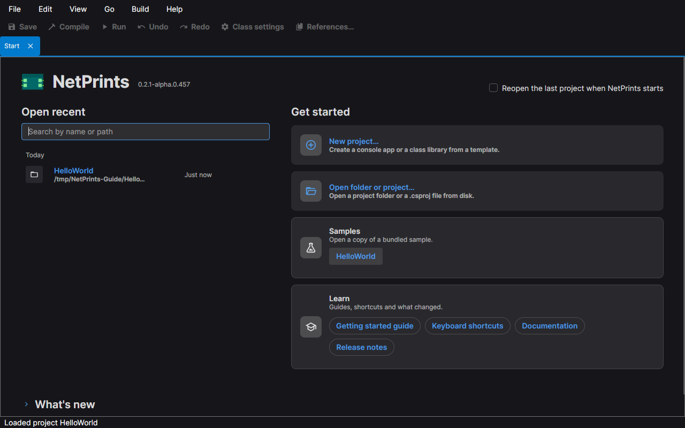
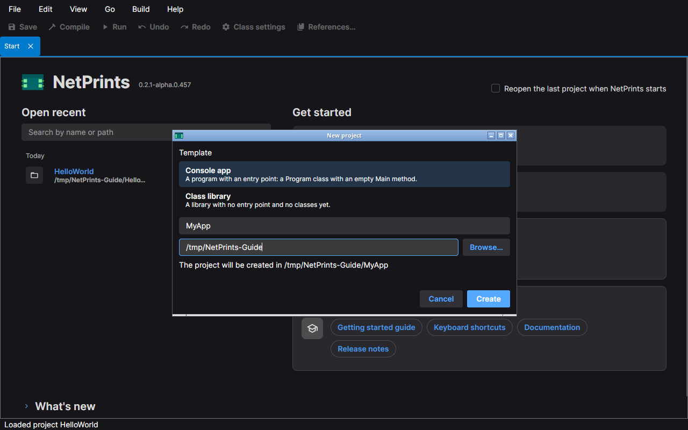
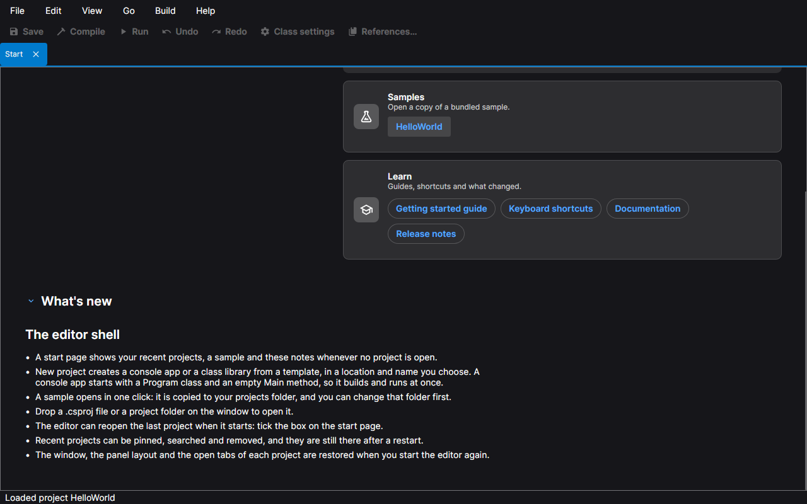

# The start page

The editor opens on the start page when no project is open. It is the **Start** tab of the document area; you can
bring it back at any time with **Help › Start page**, and it shows again when you close the project.

## Open recent

The list on the left holds the projects you opened before, newest first, under the headings Pinned, Today, This
week, This month and Older. Each row shows the project name, its folder and when you last opened it. A project whose
file has been moved or deleted is marked **Not found**.

- Click a row to open the project.
- Type in the search box to filter by name or path. Press Down to move into the list; **Enter** opens the selected
  row, **Ctrl+P** pins or unpins it and **Delete** removes it from the list.
- The pin button keeps a project at the top of the list. Pinned projects are never dropped; the list keeps the 20
  most recent unpinned ones.
- The remove button takes a project out of the list. It does not touch the project's files.

The list is kept between runs. Tick **Reopen the last project when NetPrints starts** at the top right to skip the
start page the next time. If the last start did not finish opening that project, the editor does not try again and
the start page says so.

## Get started

- **New project…** opens the New project dialog: choose a template (a Console app, which starts with a `Program`
  class and an empty `Main` that builds and runs at once, or a Class library), a name and the folder to create it
  in. The dialog says where the project will be created, and Create is enabled when the name and the folder are
  valid.

  

- **Open project…** opens a file picker for a `.csproj` file. **Open folder…** opens a folder picker and opens the
  one `.csproj` the folder holds; a folder with none or several shows an error. You can also drop a `.csproj` or such
  a folder on the window.
- **Samples** lists the samples that come with the editor. A sample opens as a copy: the dialog shows the folder
  the copy goes in, **Change…** lets you pick another, and **Copy and open** makes the copy and opens it. The
  bundled sample itself is never changed.
- **Learn** links to the getting started guide, the keyboard shortcuts sheet (it opens in the editor), the
  documentation and the release notes.

## What's new

The **What's new** heading at the bottom folds out the notes for the version you are running.

## From here

Open a project and the window changes to the layout described in [The editor window](./shell.md). For what a project
is on disk, see the [Projects guide](../projects.md).
